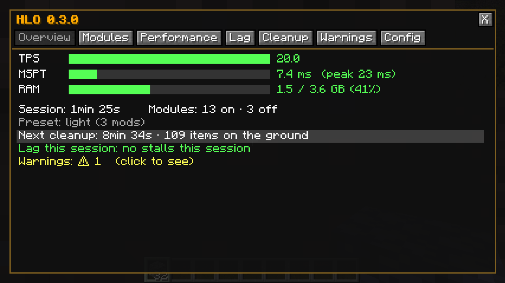
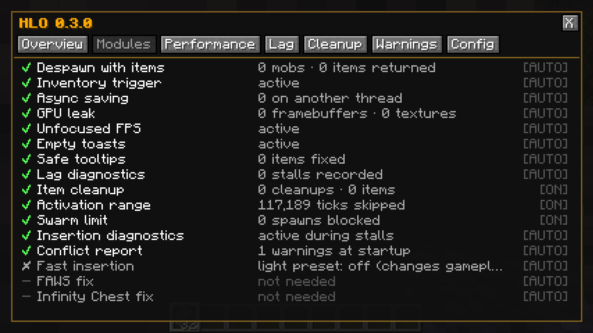
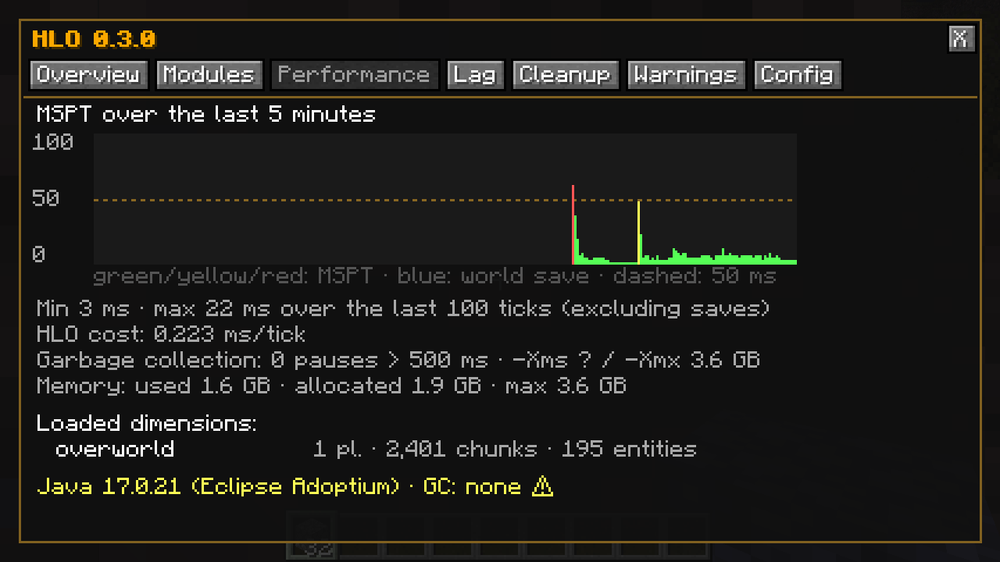

# HLO: HL Optimization

**Modular performance and stability fixes for Forge 1.20.1 modpacks.** Every module turns itself off when a mod
that does the same job is already installed, so HLO can be dropped into an existing pack without doubling up.

- Forge 1.20.1 (47.x) · server and client · **not required on both sides**
- MIT license · source and issues: https://github.com/Liesel007/Mod-Otimiza-o-

## What it does

| Module | What it does | Turns itself off if installed | Side |
|---|---|---|---|
| Async saving | Writes world data (SavedData) on another thread and waits for pending writes when the world closes | Fast Async World Save | server |
| Activation range | Entities far from every player tick once every N ticks, with exceptions (players, bosses, named, tamed, items, villagers, chunk-loader areas) | ServerCore, NoTick | server |
| Swarm limit | Cancels natural/spawner spawns of a type when there are already too many nearby (per type, you set the list) | — | server |
| Item cleanup | Removes ground items on a timer, with chat warnings and protection for valuable, recent and death-drop items | ClearLag and similar | server |
| Despawn with items | Mobs that pick up items can still despawn, and drop only what they picked up | Let Me Despawn | server |
| Inventory trigger | Skips the inventory advancement check when a stack empties, unless a pending advancement could need it | Icterine | server |
| Fast insertion *(optional)* | Inserts into very large inventories using a cache validated by the inventory itself | — | server |
| Unfocused FPS | Caps FPS when the window is unfocused or minimized | Dynamic FPS | client |
| GPU leak | Frees framebuffers mods forgot to destroy | GPU Memory Leak Fix | client |
| Empty toasts | Skips the toast layer when there are no toasts | BadOptimizations | client |
| Safe tooltips | Replaces null tooltip lines (a common crash) with empty lines and logs which item caused it | — | client |
| Lag diagnostics | When a tick takes too long, logs where the server was stuck, the likely cause and each dimension's state | — | server |
| Conflict report | Warns about known conflicts and wrong mod versions at startup | — | both |
| Fixes | Re-Avaritia Infinity Chest key growth and Fast Async World Save shutdown data loss (only on when those mods are installed) | — | — |

## Presets

`preset=auto` (default) picks a preset by mod count: **light** up to 120 mods (only fixes and diagnostics, nothing
that changes gameplay), **default** up to 250, **aggressive** above that (tighter ranges, fast insertion on). The
preset only sets defaults; anything written in `config/hlotimizacao.properties` wins.

## In-game panel

`/hl` in chat, or **F8** with HLO on the client: overview, modules (with the reason each one is off), MSPT graph,
stalls with their likely cause, item cleanup, warnings with how to fix them, and live config editing for operators.

## Safe by design

- **Safe mode**: if a module throws an error during play, that call falls back to vanilla; after 3 errors the
  module turns itself off until restart and tells you in the log and in `/hl`.
- **HLO cost**: the panel shows how many ms per tick HLO itself spends, so you can check it is worth it.
- **Clients without HLO** can join a server with HLO. Everything server-side keeps working and `/hl` works as
  chat text.
- English by default; Portuguese when Java runs in Portuguese or with `log.idioma=pt_br`.

## Measured results

Measured on a 4-core cloud Xeon with Forge 47.3.0, each module on its own. These numbers are not from a full
modpack: real gains depend on how often each situation happens in your game. The full method is
[here](https://github.com/Liesel007/Mod-Otimiza-o-/blob/HEAD/docs/benchmark.md).

| Scenario | Without HLO | With HLO |
|---|---|---|
| Main thread blocked by a 4 MB world save (median of 30) | 161 ms | 2.2 ms |
| Inventory advancement check when a stack empties | 18,286 ns/call | 5.3 ns/call |
| 10,500 cows loaded around one player (MSPT / TPS) | 246 ms / 4.1 | 45 ms / 20.0 |
| 20,500 cows | 590 ms / 1.7 | 88 ms / 11.3 |
| A 5,000-slot inventory and a 5,000-entry Infinity Chest, 4 machines at each pushing 20 stacks/tick\* | 287 ms (3.5 TPS) | 20 ms (20 TPS) |
| Same setup, burst of 400 stacks/tick\* | server crashed (60 s tick) | 18 ms (20 TPS) |
| Client CPU in the menu with the window unfocused | 193% | 67% |

\* with `insercao_rapida` and `insercao_rapida.orcamento=true` (the budget refuses extra full scans in a tick and the
machine retries next tick). Both are off by default; fast insertion is on in the aggressive preset. The cow rows use
activation range, which is on in the default and aggressive presets.

## FAQ

**Do players need it?** No. Install it on the server for the server modules; players can add it for the
client modules and the F8 panel.

**Does it replace Embeddium/ModernFix/FerriteCore?** No, it works next to them. Modules that overlap with
another mod turn themselves off.

**Where do I report a problem?** https://github.com/Liesel007/Mod-Otimiza-o-/issues. Please attach `logs/latest.log`
(search for `[HLO`).
