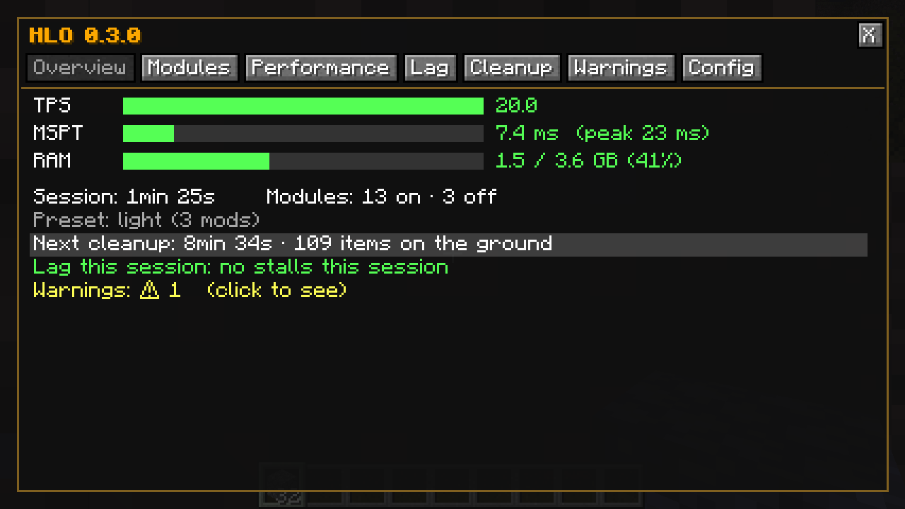
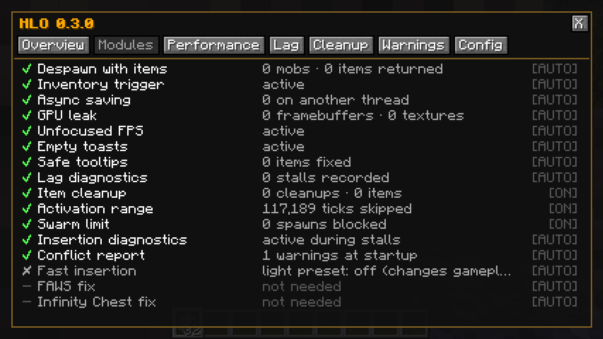
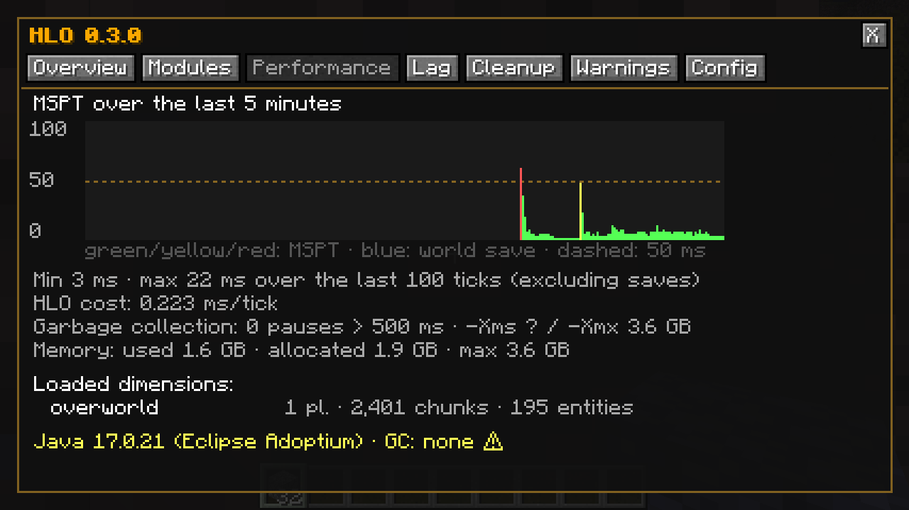

# HLO: HL Otimização

**Correções de desempenho e estabilidade, em módulos, para modpacks Forge 1.20.1.** Cada módulo se desliga
sozinho quando já existe um mod que faz o mesmo, então dá para colocar o HLO num pack pronto sem duplicar nada.

- Forge 1.20.1 (47.x) · servidor e cliente · **não precisa estar dos dois lados**
- Licença MIT · código e problemas: https://github.com/Liesel007/Mod-Otimiza-o-

## O que faz

| Módulo | O que faz | Desliga sozinho se houver | Lado |
|---|---|---|---|
| Salvamento assíncrono | Grava os dados do mundo (SavedData) em outra thread e espera as gravações ao fechar | Fast Async World Save | servidor |
| Alcance de ativação | Entidades longe de todos os jogadores tickam 1 vez a cada N ticks, com exceções (jogadores, chefes, com nome, domesticadas, itens, aldeões, áreas de chunk loader) | ServerCore, NoTick | servidor |
| Limite de enxame | Cancela o spawn natural/de spawner de um tipo quando já há muitos por perto (por tipo, você define a lista) | — | servidor |
| Limpeza de itens | Apaga os itens do chão de tempos em tempos, com aviso no chat e proteção para itens valiosos, recentes e de morte | ClearLag e parecidos | servidor |
| Despawn com itens | Mobs que pegam itens continuam podendo desaparecer e soltam só o que pegaram | Let Me Despawn | servidor |
| Gatilho de inventário | Pula a checagem de conquistas de inventário quando uma pilha esvazia, a menos que uma conquista pendente precise dela | Icterine | servidor |
| Inserção rápida *(opcional)* | Insere em inventários muito grandes com um cache conferido pelo próprio inventário | — | servidor |
| FPS sem foco | Limita o FPS com a janela sem foco ou minimizada | Dynamic FPS | cliente |
| Vazamento de GPU | Libera framebuffers que mods esqueceram de destruir | GPU Memory Leak Fix | cliente |
| Toasts vazios | Pula a camada de notificações quando não há nenhuma | BadOptimizations | cliente |
| Tooltip seguro | Troca linhas nulas de tooltip (um crash comum) por linhas vazias e diz no log qual item causou | — | cliente |
| Diagnóstico de lag | Quando um tick demora demais, registra onde o servidor travou, a causa provável e o estado de cada dimensão | — | servidor |
| Relatório de conflitos | Avisa na inicialização sobre conflitos conhecidos e versões erradas de mods | — | os dois |
| Correções | Chaves do Infinity Chest do Re-Avaritia que crescem sem parar e perda de dados ao fechar com o Fast Async World Save (só ligam com esses mods) | — | — |

## Presets

`preset=auto` (padrão) escolhe pela quantidade de mods: **leve** até 120 (só correções e diagnóstico, nada que mude o
jogo), **padrão** até 250, **agressivo** acima disso (alcances menores, inserção rápida ligada). O preset só define os
padrões; o que estiver escrito em `config/hlotimizacao.properties` tem prioridade.

## Painel no jogo

`/hl` no chat, ou **F8** com o HLO no cliente: visão geral, módulos (com o motivo de cada um estar desligado),
gráfico do MSPT, travamentos com a causa provável, limpeza de itens, avisos com a correção e edição da config para
operadores.

## Seguro por padrão

- **Modo seguro**: se um módulo dá erro durante o jogo, aquela chamada segue pelo caminho original; no 3º erro o
  módulo se desliga até reiniciar e avisa no log e no `/hl`.
- **Custo do HLO**: o painel mostra quantos ms por tick o próprio HLO gasta, para você conferir se vale a pena.
- **Cliente sem o HLO** entra num servidor com o HLO; tudo do lado do servidor continua funcionando e o `/hl`
  aparece como texto no chat.
- Inglês por padrão; português quando o Java está em português ou com `log.idioma=pt_br`.

## Resultados medidos

Medido num Xeon de 4 núcleos na nuvem, Forge 47.3.0, cada módulo isolado. Não é um modpack completo: o ganho real
depende de quanto cada situação acontece no seu jogo. Método completo
[aqui](https://github.com/Liesel007/Mod-Otimiza-o-/blob/HEAD/docs/benchmark.md).

| Cenário | Sem o HLO | Com o HLO |
|---|---|---|
| Thread principal parada num save de 4 MB (mediana de 30) | 161 ms | 2,2 ms |
| Checagem de conquista de inventário ao esvaziar uma pilha | 18.286 ns/chamada | 5,3 ns/chamada |
| 10.500 vacas carregadas em volta de um jogador (MSPT / TPS) | 246 ms / 4,1 | 45 ms / 20,0 |
| 20.500 vacas | 590 ms / 1,7 | 88 ms / 11,3 |
| Inventário de 5.000 slots e Infinity Chest de 5.000 entradas, 4 máquinas em cada despejando 20 pilhas/tick\* | 287 ms (3,5 TPS) | 20 ms (20 TPS) |
| Mesmo cenário, rajada de 400 pilhas/tick\* | servidor derrubado (tick de 60 s) | 18 ms (20 TPS) |
| CPU do cliente no menu com a janela sem foco | 193% | 67% |

\* com `insercao_rapida` e `insercao_rapida.orcamento=true` (o orçamento recusa varreduras completas a mais no tick e a
máquina tenta de novo no próximo). Os dois vêm desligados; a inserção rápida liga no preset agressivo. As linhas das
vacas usam o alcance de ativação, ligado nos presets padrão e agressivo.

## Perguntas

**Os jogadores precisam instalar?** Não. Instale no servidor para os módulos de servidor; quem quiser pode
instalar no cliente para os módulos de cliente e o painel F8.

**Substitui Embeddium/ModernFix/FerriteCore?** Não, funciona junto. Módulos que fazem o mesmo que outro mod se
desligam sozinhos.

**Onde relato um problema?** https://github.com/Liesel007/Mod-Otimiza-o-/issues, com o `logs/latest.log` (procure
por `[HLO`).
